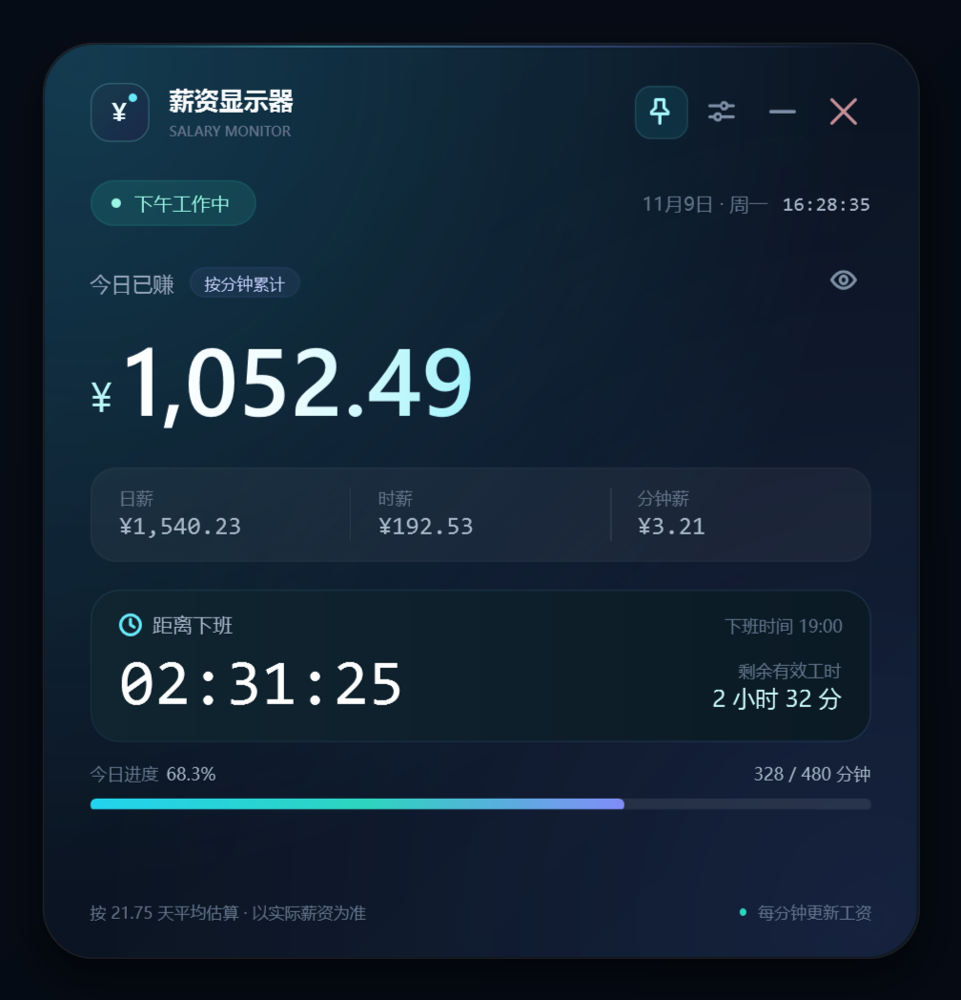

# 薪资显示器（Salary Monitor）

一个轻量的薪资显示器，提供 Windows 桌面版和 Android 手机版：按分钟累计今天的收入，按秒倒数距离下班的时间，支持完整的薪资与作息设置，并可用首页的小眼睛一键隐藏工资金额。



## 立即使用

```text
dist\薪资显示器.exe
```

双击即可运行，无需安装。

- **默认排班**：09:30–12:30、午休 12:30–14:00、14:00–19:00。
- **默认薪资**：¥33,500 / 21.75 天。
- **默认置顶**：开启，可点标题栏图钉或进入设置关闭。
- **关闭窗口**：直接退出程序，不驻留托盘。

> 首次运行若出现 Windows SmartScreen 提示，是因为 exe 未做数字签名，可选择“更多信息 → 仍要运行”。程序不联网、不需要管理员权限。

## Android 版

同一套计算规则的原生 Android 版已放在：

```text
dist\薪资显示器-Android.apk
```

- 版本 `1.2.0`（versionCode 4），支持 Android 8.0 及以上。
- 深色仪表盘、完整设置页，默认参数与 Windows 版一致。
- v1.2.0 在“今日已赚”右侧增加小眼睛按钮：一键隐藏/显示主金额和日薪、时薪、分钟薪；隐藏状态会记住，重启后保持。
- 支持“按当月实际工作日计薪”：内置 2026—2027 年法定节假日和调休表，按当月实际工作日计算日薪；默认仍为 21.75 天平均。
- v1.1.1 修复顶部品牌图标：改用独立透明圆角位图，去掉 Android 8+ 自适应图标带来的方形深色底和四角黑框。修复对比见 [资源渲染对比](docs/android/screenshots/header-icon-fix.png)。
- 手机端没有系统级窗口置顶，改用全屏显示 + 屏幕常亮。
- 不申请网络、存储、位置等权限，配置仅保存在应用私有目录。
- 首次安装需允许“安装未知应用”；APK 为本地自签名。

Android 版的构建、限制与目录说明见 [android/README.md](android/README.md)，方案与测试见 [Android 方案](docs/android/01-需求与方案设计.md)、[Android 测试用例](docs/android/02-测试用例.md)、[Android 测试记录](docs/android/03-测试记录.md)、[2026—2027 日历与工作日](docs/android/04-2026-2027日历与工作日.md)。

## 默认计算

```text
每日有效分钟 = (12:30 − 09:30) + (19:00 − 14:00) = 480 分钟
日薪         = 33,500 ÷ 21.75             ≈ ¥1,540.23
分钟薪       = 日薪 ÷ 480                  ≈ ¥3.21
时薪         = 分钟薪 × 60                  ≈ ¥192.53
```

- 工资只在**完整计薪分钟**结束时增加；倒计时每秒刷新。
- 午休 12:30–14:00 工资冻结，但距离下班的倒计时继续走。
- 平均模式下，周六、周日显示“休息日”，今日已赚 ¥0.00。
- 到达 19:00 后金额锁定为当天满额日薪，并显示“今日已下班”。
- 状态胶囊高度随字体与 DPI 自适应，状态文字优先获得宽度，避免“今日已下班”等文字被裁切。
- 金额按显示四舍五入到分，内部计算保留完整精度，不会累计舍入误差。

Android 版还可在设置中开启“按当月实际工作日计薪”：例如 2026 年 11 月有 21 个工作日，日薪为 `33,500 ÷ 21 ≈ ¥1,595.24`；法定节假日不计薪，调休周末正常计薪。

Windows v1.2.0 也提供同名开关，使用同一套 2026—2027 年节假日/调休表；默认仍为 21.75 天平均。

当前实现截图：[工作态](docs/screenshots/main-working.png)、[隐藏金额](docs/screenshots/main-hidden.png)、[午休态](docs/screenshots/main-lunch.png)、[休息日](docs/screenshots/main-weekend.png)、[设置页](docs/screenshots/settings-default.png)、[实际工作日设置](docs/screenshots/settings-actual.png)、[实际工作日主界面](docs/screenshots/main-actual.png)、[法定节假日](docs/screenshots/main-holiday.png)、[调休上班日](docs/screenshots/main-makeup.png)、[校验失败态](docs/screenshots/settings-validation-error.png)。

## 金额隐私显示

Windows 和 Android 首页的“今日已赚”右侧各有一个小眼睛按钮。点击后：

- 主金额显示为 `••••••`，日薪/时薪/分钟薪显示为 `¥••••`，不显示任何工资数字；
- 图标切换为“眼睛加斜杠”，再次点击恢复真实金额；
- 隐藏状态写入本地配置，重启应用后保持；默认启动为显示状态；
- 状态切换不影响工资计算、倒计时和进度，只是遮挡显示。

设置页仍会显示月薪等参数供编辑，本功能只遮挡首页仪表盘。

## 设置

点击标题栏的设置按钮打开设置页，可修改：

| 设置项 | 默认值 | 校验 |
|---|---:|---|
| 月薪 | 33,500.00 元 | 大于 0，且不超过 9,999,999.99 |
| 月计薪天数 | 21.75 天 | 大于 0，且不超过 31；实际工作日模式下隐藏并保留 |
| 按当月实际工作日计薪 | 关闭 | 开启后按 2026—2027 年法定节假日/调休表计算 |
| 上班时间 | 09:30 | `H:mm` 或 `HH:mm` |
| 午休开始 | 12:30 | 必须晚于上班时间 |
| 午休结束 | 14:00 | 必须晚于午休开始 |
| 下班时间 | 19:00 | 必须晚于午休结束 |
| 窗口置顶 | 开启 | 保存后生效 |

- 保存后立即生效，并按当前时间重算今日累计金额。
- 设置页实时显示日薪、分钟薪和每日有效工时预览。
- 支持“恢复默认值”；恢复后仍需要点击“保存设置”才应用。
- 配置默认保存在 `%APPDATA%\SalaryMonitor\settings.json`，应用重启后保留。
- 如果 AppData 目录不可写（例如应用被受限/低权限启动器拉起），会自动改用 exe 同目录的 `SalaryMonitor.settings.json`，并在首次切换时复制原有配置；不需要管理员权限。
- 配置文件缺失、损坏或字段非法时自动回退默认值，不会阻止启动。
- 如果保存仍提示“访问被拒绝”，请关闭程序后从文件资源管理器直接双击 exe；部分安全软件或沙箱会禁止子进程写入用户目录。

## 运行要求

- Windows 10 / 11，x64。
- **.NET Framework 4.8**（Windows 10/11 通常已内置）。exe 不附带运行时，不包含安装程序。
- 普通用户权限即可运行；默认写入 AppData，AppData 不可写时回退到 exe 同目录。不需要联网。

当前交付在 Windows 11（10.0.26200）、.NET Framework 4.8、125% 显示缩放下完成运行验证。

## 项目结构

```text
.
├─ src/                     # WPF 应用源码（纯 C#，无 XAML）
│  ├─ Core/                 # 计算、校验、格式化、配置存储
│  ├─ UI/                   # 主窗口、设置页、主题与自绘控件
│  ├─ AppClock.cs           # 系统时钟；测试构建可选注入时钟
│  ├─ Program.cs            # 应用入口
│  └─ AssemblyInfo.cs
├─ tests/                   # 无第三方依赖的自动测试程序
├─ android/                 # Android 原生源码、构建脚本与签名密钥
│  ├─ app/                  # Java 源码、Manifest、资源与布局
│  ├─ tests/                # 70 个纯 Java 核心测试
│  └─ build.ps1             # aapt2 → javac → d8 → 签名
├─ assets/                  # Windows 图标与 manifest
├─ tools/                   # 图标生成及 UI 自动化验证脚本
├─ docs/                    # 方案、测试用例、测试记录、运行截图
│  └─ android/              # Android 方案、测试用例、测试记录、2026—2027 日历
├─ build.ps1                # 运行测试 → 编译正式 exe + UI 测试版
├─ test.ps1                 # 编译并运行自动化测试
└─ dist/                    # 最终便携程序 + Android APK
```

## 构建与测试

要求本机具备 .NET Framework 4.8 自带的 C# 编译器；不需要 .NET SDK、Node.js、NuGet 或网络。

```powershell
# 运行自动化测试并构建正式 exe
powershell.exe -NoLogo -NoProfile -ExecutionPolicy Bypass -File .\build.ps1

# 只运行测试
powershell.exe -NoLogo -NoProfile -ExecutionPolicy Bypass -File .\test.ps1

# 只编译、不跑测试
powershell.exe -NoLogo -NoProfile -ExecutionPolicy Bypass -File .\build.ps1 -SkipTests

# Android：运行 70 个核心测试并构建 APK
powershell.exe -NoLogo -NoProfile -ExecutionPolicy Bypass -File .\android\build.ps1
```

构建会生成：

- `dist\薪资显示器.exe`：正式单文件程序。
- `build\SalaryMonitor.UITest.exe`：仅用于自动化/截图验证的测试构建（支持固定时钟与配置路径覆盖）。
- `build\tests\test-output.txt`：自动测试完整输出。

> UI 测试构建中的时钟注入和配置目录覆盖均在 `UI_TEST_BUILD` 条件下编译，正式 exe 不包含这些入口。

## 已知限制

- 这是**估算展示工具**，不是薪资核算系统；不处理个税、社保、请假、加班和实际发薪。
- Windows 和 Android 均可开启实际工作日模式，内置 2026—2027 年官方节假日/调休表；其他年份回退为周一至周五。默认平均模式仍仅按周末判断。
- 支持一段午休、同一天内完成的班次；不支持跨天班次或多段休息。
- 不显示本月累计金额。
- Windows 版无数字签名、无自动更新、无系统托盘、无开机启动；Android 版为本地自签名，签名密钥和密码不进入 Git 仓库。
- 修改系统时间会直接影响金额和倒计时显示。

更完整的方案、测试用例与执行结果：

- [产品与方案设计](docs/01-需求与方案设计.md)
- [测试用例](docs/02-测试用例.md)
- [测试记录](docs/03-测试记录.md)

---

Windows 版：**1.2.0** · Android 版：**1.2.0** · 构建日期：2026-11-14
