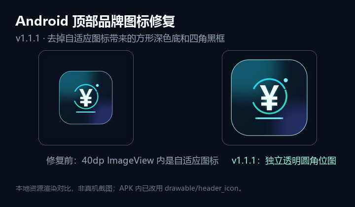

# Android 版测试记录

- 版本：v1.2.0（versionCode 4）
- 构建日期：2026-11-14
- 构建环境：Windows 11 10.0.26200 x64
- JDK：Microsoft OpenJDK 17.0.21.0.2
- Android SDK：Platform 34 / Build-Tools 34.0.0 / Platform-Tools 37.0.1
- 产物：`dist/薪资显示器-Android.apk`
- 大小：273,952 字节
- SHA-256：`9DB2A176487F91FDBC9989F2F9E2011C0E2A1DD4CF58575A5DCE71EA0BFFEF73`
- 日历数据：[2026—2027 日历与工作日](04-2026-2027日历与工作日.md)
- 顶部图标修复对比：[资源渲染对比](screenshots/header-icon-fix.png)

## 1. 自动化核心测试

命令：

```powershell
powershell.exe -NoProfile -ExecutionPolicy Bypass -File .\android\build.ps1
```

结果：

```text
Automated tests: 70 passed, 0 failed.
RESULT: PASS
```

覆盖范围：

- 默认日薪/时薪/分钟薪/480 分钟
- 09:30:00、09:30:59、09:31:00 的整分钟边界
- 午休开始/结束、下午恢复、下班封顶
- 周末与周五
- 自定义 510 分钟/420 分钟作息
- 金额、倒计时、进度、工时、日期/时钟格式化
- 金额/时间解析与非法输入
- 月薪/天数/时间范围/时间顺序校验
- 状态文案、倒计时标题、更新提示（实际模式增加“节假日休息”）
- 配置复制与默认值
- 2026/2027 年逐月实际工作日数、全年 248 天
- 元旦/春节/清明/劳动/端午/中秋/国庆放假与调休日
- 实际工作日模式日薪、分钟薪、今日已赚
- 法定节假日 0 元、调休周末正常计薪
- 2028 年无数据时的周一至周五回退
- 实际工作日开关的复制与持久化字段
- 金额隐私占位符（`••••••` / `¥••••`）不含数字或小数点
- 金额隐藏字段的默认值与 `copy()` 保留

v1.1.1 只修改顶部品牌图标的资源引用；v1.2.0 增加金额隐私开关。核心测试数量从 69 个增加到 70 个。
图标资源与布局通过第 3、7 节和 BUILD-013、BUILD-014 做静态校验；真机视觉见第 5 节待执行项。

完整输出见构建日志；测试源码见 [CoreTests.java](../../android/tests/CoreTests.java)。

## 2. 构建流水线结果

| 步骤 | 工具 | 结果 |
| --- | --- | --- |
| 资源编译 | `aapt2 compile` | PASS |
| 资源链接 + Manifest | `aapt2 link` | PASS |
| Java 编译 | `javac --release 8` | PASS |
| dex | `d8 --min-api 26` | PASS，生成 `classes.dex` |
| 对齐 | `zipalign -f 4` | PASS，`zipalign -c -v 4` 通过 |
| 签名 | `apksigner sign` | PASS |
| 签名校验 | `apksigner verify` | PASS，v2 + v3 |
| 清单/包信息 | `aapt2 dump badging` | PASS |
| 顶部图标 / 金额隐私资源 | `aapt2 dump resources` / `xmltree` | PASS，详见第 3 节 |

签名信息：

```text
Verifies
Verified using v1 scheme (JAR signing): false
Verified using v2 scheme (APK Signature Scheme v2): true
Verified using v3 scheme (APK Signature Scheme v3): true
Number of signers: 1
Signer #1 certificate DN: CN=Salary Monitor, O=Personal, C=CN
Signer #1 certificate SHA-256 digest:
  61d82eaaf9d8a7f5565db9f65631f599419f233b3bad3e0e0414fb84d7cf3948
```

说明：minSdk 26 支持 APK Signature Scheme v2，v1 未启用不影响 Android 8+ 安装。
本次升级继续使用同一把密钥，因此可以覆盖安装 v1.1.1 / v1.1.0。
签名密码从本地 `android/signing/keystore.properties` 读取，不写入源码，也不提交到仓库。

## 3. APK 结构与顶部图标修复

`aapt2 dump badging`：

```text
package: name='com.salarymonitor.app' versionCode='4' versionName='1.2.0'
sdkVersion:'26'
targetSdkVersion:'34'
application-label:'薪资显示器'
launchable-activity: name='com.salarymonitor.app.MainActivity'
```

- APK 条目：47 个。
- 包含：`AndroidManifest.xml`、`classes.dex`、`resources.arsc`、
  `res/layout/activity_main.xml`、`res/layout/activity_settings.xml`、
  `res/drawable-*`、`res/mipmap-*`。
- 新增 `res/drawable-mdpi-v4/header_icon.png` 至
  `res/drawable-xxxhdpi-v4/header_icon.png`，共 5 个密度的普通 PNG。
- `classes.dex` 头为 `dex\n038\0`，DEX 版本有效。
- `dexdump` 能解析出 `MainActivity`、`SettingsActivity`、
  `SettingsRepository`、`WorkdayCalendar`、`DayKind`、`ProgressBarView`、
  `GradientTextView` 等类。
- 资源表包含 `actualWorkdaysSwitch`、`actualHint`、`daysColumn`、
  `amountVisibilityButton`、`ic_eye`、`ic_eye_off` 和 `header_icon` 等 ID。
- 中文资源表包含“薪资显示器”“保存设置”“屏幕常亮”等文案。

### 3.1 问题原因

v1.1.0 的顶部品牌图标直接使用：

```xml
<ImageView
    android:layout_width="40dp"
    android:layout_height="40dp"
    android:scaleType="centerCrop"
    android:src="@mipmap/ic_launcher" />
```

在 Android 8.0+ 上，`@mipmap/ic_launcher` 会解析到：

```text
res/mipmap-anydpi-v26/ic_launcher.xml
  <adaptive-icon>
    <background android:drawable="@color/icon_background" />
    <foreground android:drawable="@drawable/ic_launcher_foreground" />
  </adaptive-icon>
```

- 自适应图标的背景层 `#0B1020` 会铺满整个 ImageView 方形边界；
- 前景圆角图标只占前景 PNG 约 68%，四周留有透明安全区；
- 因此圆角图标外侧、尤其是四个角，会露出接近黑色的方形背景，
  在深色界面上看起来就是“圆角图标带四个黑角/黑框”。

启动器使用自适应图标是正常的，系统会按桌面图标形状裁切；
问题只出在应用内把自适应图标当作普通 `ImageView` 图片使用。

### 3.2 v1.1.1 修复

- 新增独立的 `header_icon.png`，从 1024px 应用图标生成：
  - mdpi 48px、hdpi 72px、xhdpi 96px、xxhdpi 144px、xxxhdpi 192px；
  - 使用预乘 alpha 缩放后再反预乘，避免缩放产生黑色边缘；
  - PNG 四角 alpha 为 0，圆角外完全透明。
- 顶部布局改为：

```xml
<ImageView
    android:layout_width="40dp"
    android:layout_height="40dp"
    android:background="@android:color/transparent"
    android:scaleType="fitCenter"
    android:src="@drawable/header_icon" />
```

- 不再引用自适应 `mipmap/ic_launcher`；`header_icon` 没有 anydpi 版本，
  使用普通 PNG，不会绘制方形背景层。
- 启动器图标（`android:icon` / `android:roundIcon`）仍保留自适应图标，
  本次不改变桌面图标外观。
- 图标生成脚本：`tools/make_android_header_icon.py`。

### 3.3 静态校验结果

`aapt2 dump resources`：

```text
resource 0x7f02000e drawable/header_icon
  (mdpi) (file) res/drawable-mdpi-v4/header_icon.png type=PNG
  (hdpi) (file) res/drawable-hdpi-v4/header_icon.png type=PNG
  (xhdpi) (file) res/drawable-xhdpi-v4/header_icon.png type=PNG
  (xxhdpi) (file) res/drawable-xxhdpi-v4/header_icon.png type=PNG
  (xxxhdpi) (file) res/drawable-xxxhdpi-v4/header_icon.png type=PNG
```

没有 `anydpi`、`v26` 或 adaptive-icon XML 版本。

`aapt2 dump xmltree --file res/layout/activity_main.xml`：

```text
E: ImageView
  A: android:background=@0x0106000d        # @android:color/transparent
  A: android:layout_width=40.000000dp
  A: android:layout_height=40.000000dp
  A: android:src=@0x7f02000e               # @drawable/header_icon
  A: android:scaleType=3                   # fitCenter
  A: android:contentDescription=@string/app_name
```

从 APK 中解出 `res/drawable-xxxhdpi-v4/header_icon.png` 后检查：

```text
size: 192 × 192
alpha bbox: (1, 1, 191, 191)
corner (0, 0):   alpha = 0
corner (1, 1):   alpha = 0
corner (191,191): alpha = 0
edge   (96, 0):  alpha = 0
```

即图标四角和外沿均为透明，圆角内部保持完整不透明；
不会在应用深色背景上生成方形黑底。

资源渲染对比（本地按 4× 放大模拟，不是真机截图）：

[](screenshots/header-icon-fix.png)

左侧是 v1.1.0 在 ImageView 中直接绘制自适应图标的效果：圆角图标周围、
四个角出现深色方形底；右侧是 v1.1.1 的独立透明圆角位图。

### 3.4 v1.2.0 金额隐私显示

首页“今日已赚”行新增 `amountVisibilityButton`，布局尺寸 36dp，
引用 `@drawable/ic_eye`，隐藏时由 `MainActivity` 切换为
`@drawable/ic_eye_off`。静态校验结果：

```text
resource 0x7f020011 drawable/ic_eye
  () (file) res/drawable/ic_eye.xml type=XML
resource 0x7f020012 drawable/ic_eye_off
  () (file) res/drawable/ic_eye_off.xml type=XML
resource 0x7f030003 id/amountVisibilityButton
```

```text
E: ImageButton
  A: android:layout_width=36.000000dp
  A: android:layout_height=36.000000dp
  A: android:src=@0x7f020011               # @drawable/ic_eye
  A: android:contentDescription=@0x7f060003 # @string/hide_amount
```

- `MainActivity` 点击后切换 `amountsHidden`：
  - 主金额使用 `Formatters.HIDDEN_AMOUNT`，显示为 `••••••`；
  - 日薪/时薪/分钟薪使用 `Formatters.HIDDEN_MONEY`，显示为 `¥••••`；
  - `ImageButton` 的图标与 contentDescription 在“隐藏工资/显示工资”间切换。
- 隐藏状态由 `SettingsRepository` 写入私有 SharedPreferences 的
  `amounts_hidden`，默认 `false`；`SettingsActivity` 保存其他参数时保留该字段。
- 仅新增两个本地 vector drawable 与一个字符串，不新增任何权限。
- 当前没有真机/模拟器，点击交互与真机视觉仍列入第 5 节待执行项；
  纯 JVM 测试覆盖占位符与配置复制，资源级检查由 BUILD-014 覆盖。

## 4. 权限与数据

`aapt2 dump permissions`：

```text
package: com.salarymonitor.app
```

没有列出任何 `uses-permission`。

- 不申请 `INTERNET`、存储、位置、通讯录、相机、麦克风、通知权限。
- 不包含网络请求代码。
- 配置只写入应用私有 `SharedPreferences`（`salary_monitor`）。
- 卸载应用即清除配置。

## 5. 设备/模拟器测试状态

当前环境没有连接 Android 真机。2026-11-05 复核模拟器问题，结论：
**不是 APK 的问题，是 Android Emulator/QEMU 在本机启动阶段异常**。
v1.2.0 构建没有重复尝试模拟器，设备项仍待执行。

已尝试的组合：

- Emulator `37.2.13` 和 `35.3.12`；
- WHPX 硬件加速和 TCG 软件加速；
- 无窗口和窗口模式；
- `swiftshader_indirect`、`host`、`off` 三种 GPU 模式；
- API 30 AOSP ATD x86_64（Pixel 2，2 GB RAM）；
- 禁用 QuickbootFileBacked、快照、Vulkan；
- 修正 `ANDROID_EMULATOR_HOME` 和 `%TEMP%\avd\running`。

现象：

- `emulator -accel-check` 报告
  `WHPX(10.0.26200) is installed and usable`；
- QEMU 进程启动后 guest 内核没有任何输出，ADB 一直处于 `offline`；
- QEMU 线程全部处于 `WaitReason=Suspended`；手动恢复后 CPU 仍不推进；
- WER/崩溃转储记录 `qemu-system-x86_64-headless.exe` 异常
  `0xc0000005`，后续运行出现 `0x40000015`（`STATUS_FATAL_APP_EXIT`）；
- 崩溃转储加载了 `WinHvPlatform.dll`、`WinHvEmulation.dll`、
  `vulkan-1.dll`、`vk_swiftshader.dll`；
- `crashpad_handler.exe` 自身也在启动时异常（`0x80000003`），
  导致转储不完整；
- 宿主为 Surface Laptop Go（i5-1035G1，8 GB，VBS/Hyper-V 运行中），
  Windows 11 `26200`，且存在**待重启的 Windows 更新**，
  可用物理内存约 1.6–1.9 GB。

判断：

- APK 的 DEX、资源、签名、清单均正常，70 个核心逻辑测试全部通过；
- 失败发生在 QEMU/虚拟化/图形初始化阶段，早于 Android 系统启动，
  与 APK 业务代码无关；
- 最可能的修复方向是完成 Windows 更新重启、释放内存、更新显卡驱动；
  若仍失败，需要关闭 VBS/Hyper-V 或改用真机/云设备。

因此以下项目**尚未在真实 Android 运行时验证**：

- 实际安装/启动/首屏渲染；
- 状态胶囊、金额、倒计时在 360dp/320dp 下的最终视觉效果；
- v1.2.0 点击小眼睛后的图标、`••••••` / `¥••••` 排布与点击区域；
- v1.1.1 顶部 40dp 图标在真机上的最终视觉（资源层面已确认四角透明）；
- 时间选择器、键盘、返回键、屏幕常亮的实际交互；
- Android 真机字体与系统栏适配。

这些项目需要在手机上安装 APK 后按 [测试用例](02-测试用例.md) 的
UI-010–UI-025、BUILD-009–BUILD-014 人工核对。当前可确认的是：
APK 结构完整、签名有效、清单正确、无敏感权限，
70 个核心逻辑测试通过，顶部图标资源与金额隐私资源均已正确打包。

## 6. 当前结论

- **计算逻辑**：通过（70/70）。
- **构建/打包/签名**：通过。
- **清单/权限/DEX/资源结构**：通过。
- **顶部图标修复**：通过资源级静态验证（BUILD-013）；真机视觉待核对。
- **金额隐私显示**：通过占位符、配置复制和资源级静态验证（BUILD-014）；真机点击待核对。
- **真实设备 UI**：待真机验证。

建议先在手机覆盖安装 v1.2.0，重点检查：

1. 点击“今日已赚”右侧小眼睛，主金额与三项费率是否全部遮挡；
2. 再次点击是否恢复真实金额，图标是否在眼睛/斜杠眼睛间切换；
3. 隐藏后杀进程重开，是否仍保持隐藏；
4. 顶部“薪资显示器”左侧图标四角是否与背景融合，无方形黑底；
5. 实际工作日开关、设置页时间选择器和保存后回显是否正常。

## 7. 已知限制

- 实际工作日表目前只覆盖 2026—2027 年；其他年份回退为周一至周五。
- 实际工作日数按国务院放假安排计算，不处理公司自定义排班、请假、加班。
- 不支持跨天班次、多段午休。
- 无窗口置顶/悬浮窗/通知栏常驻/桌面小组件。
- 屏幕常亮仅在应用前台有效；锁屏或系统杀进程后停止刷新。
- 本地自签名，未上架应用商店；首次安装需允许未知来源。
- 修改系统时间会直接影响金额和倒计时。
- 启动器桌面图标仍使用自适应图标；本次只修复应用内顶部品牌图标。
